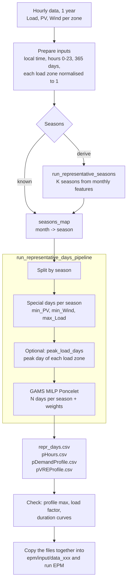

# Run the representative-days pipeline

The pipeline turns one year of hourly load, solar and wind data into a small set of representative days with weights. It writes the EPM time-slice files `pHours.csv`, `pDemandProfile.csv` and `pVREProfile.csv`. The method is described in [Representative Days](../input/input_representative_days.md). This page explains how to run it.

Code: `pre-analysis/representative_days/`

| File | Use |
|---|---|
| `representativedays_pipeline.py` | `run_representative_days_pipeline()`, the end-to-end function |
| `representativeseasons_pipeline.py` | `run_representative_seasons()`, optional: groups months into seasons |
| `gams/OptimizationModelZone.gms` | the day-selection MILP, called by the pipeline |
| `Run_repdays.py` | minimal example with dummy data |
| `Run_repdays_SAPP_2024.ipynb` | full worked example (SAPP 2024): cleaning, checks, EPM files, demand correction |

## Overview



## Requirements

- The `epm_env` conda environment (see [Run with Python](../run/run_python.md)).
- GAMS on the `PATH` with a MIP solver licence (CPLEX by default). The selection is solved by GAMS.
- Run Python from `pre-analysis/representative_days/`. The pipeline looks for `gams/` relative to the working directory, unless you pass an absolute `gams_main_file`.

## 1. Prepare the input files

There is one CSV per technology. Each file is in long format, with one row per zone and hour:

```text
zone,month,day,hour,value
South_Africa,1,1,0,0.712
South_Africa,1,1,1,0.668
...
Botswana,12,31,23,0.701
```

| Rule | Why |
|---|---|
| Columns `zone, month, day, hour` and one value column (`value` by default, set with `value_column`) | Input validation |
| **Hours 0–23** (hour beginning). Convert 1–24 data before running. | The validation rejects hour 24 |
| **365 days**: drop 29 February | Days are counted per season |
| **Same time zone for all series**, preferably local time. ERA5 and renewables.ninja are in UTC. ERA5 radiation is accumulated over the previous hour, so shift it one more hour. | Otherwise the solar peak and the evening load peak are misaligned |
| **Normalise each load zone to its own peak** (max = 1) before the pipeline | The pipeline divides by the maximum over all zones, so small zones would never reach 1 |
| PV and wind as capacity factors (0–1) | Profiles are written as given |
| Clean outages and spikes in the load (see section 2 of the SAPP notebook) | A blackout day can be picked as min-load day, and a spike sets a false peak |

Example: going from a wide hourly table (one column per zone) to the input format:

```python
import pandas as pd

wide = pd.read_csv('my_load_hourly.csv', parse_dates=['time'])       # time, ZoneA, ZoneB, ...
wide = wide[~((wide.time.dt.month == 2) & (wide.time.dt.day == 29))]
long = wide.melt(id_vars='time', var_name='zone', value_name='value')
long['value'] = long['value'] / long.groupby('zone')['value'].transform('max')   # each zone max = 1
long['month'], long['day'], long['hour'] = long.time.dt.month, long.time.dt.day, long.time.dt.hour   # 0-23
long[['zone', 'month', 'day', 'hour', 'value']].to_csv('input/load_data.csv', index=False)
```

## 2. Define the seasons

`seasons_map` maps each month (1–12) to a season number. Each season gets its own set of days.

**Fixed seasons.** Example: calendar quarters, as in most EPM datasets (`Q1` … `Q4`):

```python
seasons_map = {m: (m - 1) // 3 + 1 for m in range(1, 13)}
```

**Derived seasons.** Contiguous months are grouped by similarity of their load, PV and wind:

```python
from representative_days.representativeseasons_pipeline import run_representative_seasons

seasons_map = run_representative_seasons(input_files=input_files, K=2,          # e.g. wet / dry
                                         output_path='output/seasons.csv')
```

Use the same seasons as the rest of the EPM dataset (for example `pAvailability` and hydro by season).

## 3. Run the pipeline

### Example 1: minimal run

```python
import sys
from pathlib import Path
sys.path.insert(0, str(Path.cwd().parent))          # run from pre-analysis/representative_days
from representative_days.representativedays_pipeline import run_representative_days_pipeline

input_files = {'PV': 'input/pv_data.csv', 'Wind': 'input/wind_data.csv', 'Load': 'input/load_data.csv'}
seasons_map = {m: (m - 1) // 3 + 1 for m in range(1, 13)}

res = run_representative_days_pipeline(
    seasons_map=seasons_map,
    input_files=input_files,
    output_dir='output/my_study',
    n_representative_days=2,          # optimised days per season (special days come on top)
    year_label=2024,
    gams_main_file=str(Path('gams/OptimizationModelZone.gms').resolve()),
)
print(res['repr_days'])               # season, day, weight, rule, daytype
```

`Run_repdays.py` does the same with dummy data. Run it to test the installation:

```bash
conda activate epm_env
cd pre-analysis/representative_days
python Run_repdays.py
```

### Example 2: keep the peak of every zone (recommended for multi-zone studies)

By default the `max_Load` special day is chosen on the **system-wide** load. A zone whose peak falls on another day then has a profile maximum below 1. EPM scales demand so that the profile maximum equals the forecast peak, so that zone's modelled peak ends up below the forecast. With `peak_load_days=True`, the actual peak day of each load series is added with a weight of 1:

```python
res = run_representative_days_pipeline(seasons_map=seasons_map, input_files=input_files,
                                       output_dir='output/my_study_peaks', n_representative_days=2,
                                       peak_load_days=True, year_label=2024,
                                       gams_main_file=str(Path('gams/OptimizationModelZone.gms').resolve()))
print(res['peak_load_days'])          # series, season, day, hour, peak, action
```

The `action` column tells how each peak day was added:

- **removed from optimisation pool**: the day becomes a special day with a weight of 1.
- **taken from special day ...**: the day was already in the same cluster as a special day, which gives up one day of weight.
- **already a selected day**: nothing is added.

In the SAPP 2024 example this option raised the number of days from 20 to 31. Every zone's profile then reaches 1.00, instead of a maximum between 0.81 and 0.97.

### Example 3: many zones

Every series and every pairwise correlation adds variables to the MILP. With 12 load series and 15 PV and 15 wind series, each season takes 4–15 minutes (about 30 minutes per run). To keep it tractable:

- **Use a subset of zones.** Use one PV and one wind site per country for the selection, then build the profiles of all zones afterwards from the selected days (SAPP notebook, step 7).
- **Drop zones** with `zones_to_exclude=['ZoneX', ...]`.
- **Let the pipeline select series** with `feature_selection_count=n`, which keeps `n` representative series by hierarchical clustering.

```python
res = run_representative_days_pipeline(seasons_map=seasons_map, input_files=input_files,
                                       output_dir='output/my_study_fs', n_representative_days=2,
                                       feature_selection_count=15, zones_to_exclude=['Gabon'],
                                       year_label=2024, verbose=False,
                                       gams_main_file=str(Path('gams/OptimizationModelZone.gms').resolve()))
```

In a notebook, run it with no cell time limit (`--ExecutePreprocessor.timeout=-1` with `nbconvert`). Otherwise save `repr_days.csv` and read it back, as `REUSE_RUNS` does in the SAPP notebook.

### Example 4: a fixed, small number of days for EPM

The number of days drives the size of the EPM problem. Each season has `n_representative_days` optimised days plus one day per special-day type, so the default gives 4 × (2 + 3) = 20 days for 4 seasons, and `peak_load_days=True` adds more. To get 16 days (4 per season) with the system peak day and 3 optimised days:

```python
res = run_representative_days_pipeline(seasons_map=seasons_map, input_files=input_files,
                                       output_dir='output/my_study_16d', n_representative_days=3,
                                       special_day_features=('Load',),     # drop the min-PV and min-wind days
                                       year_label=2024,
                                       gams_main_file=str(Path('gams/OptimizationModelZone.gms').resolve()))
```

Without the country peak days, some zone profiles peak below 1. Rescale each zone's profile so its maximum on the selected days is 1 before using it in EPM: EPM then keeps every forecast peak, and its energy correction keeps the forecast energy. Check afterwards that no hour becomes negative (SAPP notebook, section 10).

### Main parameters

| Parameter | Default | Meaning |
|---|---|---|
| `n_representative_days` | 2 | Days per season chosen by the MILP. Total = seasons × (N + special days) |
| `peak_load_days` | False | Add the peak day of each load series (Example 2) |
| `n_clusters` | 20 | Clusters used to find the special days |
| `special_day_features` | `('PV', 'Wind', 'Load')` | Special days per season: lowest PV, lowest wind, highest load. `('Load',)` keeps the peak day only, `()` none (Example 4) |
| `special_day_threshold` | 0.1 | Probability cutoff when extracting special days |
| `n_bins` | 10 | Bins of the duration curves in the MILP (more = finer, slower) |
| `feature_selection_count` | None | Keep only `n` series before the MILP |
| `zones_to_exclude` | None | Zones dropped before processing |
| `value_column` | `'value'` | Value column of the input files |
| `year_label` | 2019 | Label of the data year |
| `data_dir`, `epm_output_dir`, `summary_dir` | `output_dir` | Where intermediate, EPM and summary files go |

## 4. Outputs

All in `output_dir` unless redirected:

| File | Content |
|---|---|
| `repr_days.csv` | Selected days: season, day of season, weight, rule (`representative`, `min_PV`, `min_Wind`, `max_Load`, `peak_Load_<zone>`), EPM label `d1`… |
| `pHours.csv` | Weight of each day (days per year it stands for) → `epm/input/data_xxx/pHours.csv` |
| `pDemandProfile.csv` | Normalised load on the selected days → `load/pDemandProfile.csv` |
| `pVREProfile.csv` | PV and wind profiles on the selected days → `supply/pVREProfile.csv` |
| `peak_load_days.csv` | Only with `peak_load_days=True` |
| `representative_days_summary.csv`, `representative_days_heatmap.pdf` | Overview of the selection |
| `OptimizationModelZone.lst` | GAMS listing (solver status and time per season) |

`pVREProfile.csv` is written as `zone,fuel,season,daytype,t1..t24`, with the names of `input_files` (`PV`, `Wind`). Compare it with the header of the dataset's current file (for example `zone,tech,q,d`). Rename the columns and technologies (`PV`, `OnshoreWind`...) to match, and add the missing zone-tech pairs (for example `OffshoreWind`, `CSPPlant`) before using the file. Step 7 of the SAPP notebook shows how, with rescaling to a target capacity factor.

## 5. Check before using the files in EPM

1. **Weights add up**: the weights of each season equal its number of days, and the total is 365.
2. **Profile max = 1 in every zone.** Otherwise the modelled peak is below the forecast. Use `peak_load_days=True`.
3. **Load factor of the selected days ≈ the observed one.** Also compare the duration curves of the full year and the selected days.
4. **Demand forecast consistent with the profile.** EPM corrects the hourly demand so that annual energy matches the forecast. If the forecast load factor (energy / (peak × 8760)) is much lower than the profile's, some hours become **negative**. Fix the forecast, or use a profile with that load factor (SAPP notebook, section 8).
5. **Avoid a perfectly flat profile** (max = min) for a zone. `generate_demand.gms` divides by (max − min)². Use a near-flat profile such as 0.98 + 0.02 × shape.

Then copy `pHours.csv`, `pDemandProfile.csv` and `pVREProfile.csv` **together**, plus any other file indexed by `(q, d, t)` such as `pVREgenProfile` and `pTradePrice`. The day labels `d1`, `d2`… refer to new calendar days, so mixing old and new files pairs the wrong days. Check with:

```bash
cd epm
python epm.py --folder_input data_xxx --check_inputs
```

## Troubleshooting

| Symptom | Cause / fix |
|---|---|
| Validation error on hour 24 | Convert to hours 0–23 |
| A small zone's profile never reaches 1 | Normalise each zone before the pipeline |
| Model peak below the forecast peak | `peak_load_days=True` |
| Solar peak at night or shifted | UTC data not converted to local time |
| GAMS not found / model not found | GAMS not on `PATH`, or not run from `pre-analysis/representative_days` (pass an absolute `gams_main_file`) |
| Run takes very long | Fewer series (Example 3), lower `n_bins` |
| Negative hourly demand in EPM | Forecast load factor too low for the profile (section 5, point 4) |
