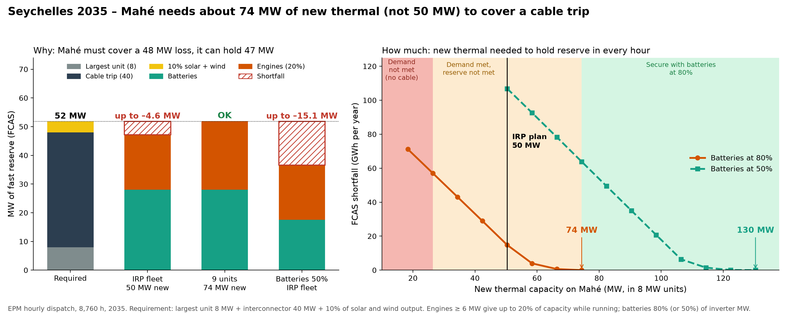
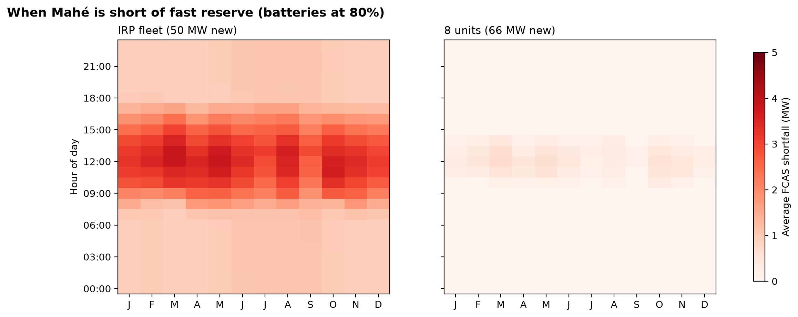
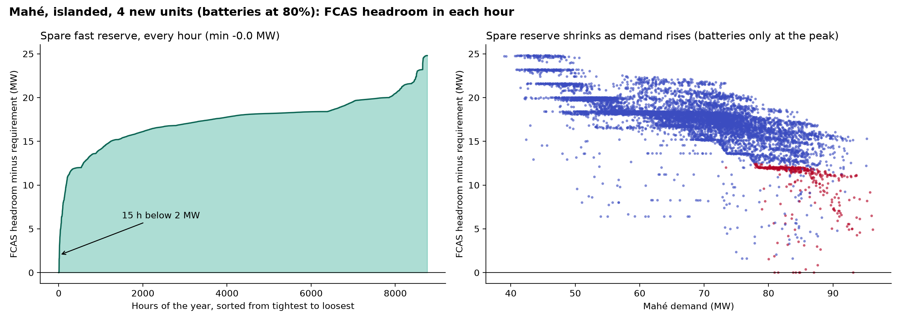

# Seychelles 2035 – FCAS and minimum new thermal (EPM dispatch)

*Runs of 16 October 2026. Thermal and waste-to-energy available at 90%, solar and wind at 95% of capacity in every
hour; FCAS shortfall penalty USD 500 per MW-h (below unserved energy, USD 1,000 per MWh). Relaxed unit commitment
(LP).*

## Main story

1. **With the IRP fleet (50 MW of new HFO), Mahé cannot hold enough fast reserve (FCAS) to cover a cable trip** – it
   is short in every hour of 2035, by up to 4.4 MW. The requirement (largest unit 8 MW + 40 MW cable + 10% of solar
   and wind) is 48–52 MW; the most Mahé can hold is 47 MW.
2. **About 74 MW of new thermal (nine 8 MW units) is needed** to hold FCAS in every hour with batteries counted at
   80% of inverter capacity, and **about 130 MW (16 units)** if batteries count at 50%.
3. **Demand alone needs about 34 MW (four units)**, even without the cable. Four units is the bare minimum (spare
   reserve reaches zero in a few hours); five units leave at least 9.6 MW spare. Between four and eight units Mahé
   meets demand but not FCAS with the cable in service.
4. **Without the interconnector Mahé carries less reserve but burns more HFO: about USD 8.5 m/yr more fuel**
   (USD 7 m/yr more operating cost) at the IRP fleet.
5. **The extra units are for reserve, not energy**: operating cost barely changes (USD 74.7 m/yr at 6 units,
   74.3 m/yr at 9 units; capital cost not included).
6. **FCAS stays scarce even at the threshold**: with 9 units the FCAS price on Mahé averages USD 50 per MW-h and
   exceeds USD 100 in about 1,200 hours.



**Figure 1.** Left: requirement on Mahé against the reserve it can hold from batteries and engines. Right: annual FCAS
shortfall as new thermal is added; zones show where demand is not met (no cable), where demand is met but reserve is
not, and where Mahé is secure with batteries at 80%.



**Figure 2.** Average FCAS shortfall by month and hour: with the IRP fleet Mahé is short in every hour, worst at midday
(10% of solar output adds to the requirement); one unit below the threshold, only a midday gap remains.



**Figure 3.** Islanded Mahé with 4 new units (batteries at 80%): spare fast reserve in each hour (reserve that could be
held given the dispatch, minus the requirement). It just reaches zero and is below 2 MW in 15 hours. With 3 units
([figure](figures/fig3_Islanded_U3_fcas_margin.png)) it goes negative (down to –4.9 MW, 30 hours) and 406 MWh of demand
is unserved; with batteries at 50% and 4 units ([figure](figures/fig3b_IslBESS50_U4_fcas_margin.png)) it is below
2 MW in 470 hours.

## Model

- EPM in dispatch mode: two zones (Mahé, Praslin–La Digue) linked by the planned 40 MW cable, 8,760 hours of 2035,
  no capacity expansion. Energy and reserve are co-optimised at least cost.
- Engines: unit commitment (minimum load 30% of rated MW, minimum up/down time, start-up cost); reserve only while
  running, up to 20% of rated MW, and output + reserve within the available (90%) capacity.
- Batteries: reserve up to 80% (or 50%) of inverter MW; charge + discharge within the inverter; discharge + reserve
  backed by the energy stored at the start of the hour.
- Penalties: unserved energy USD 1,000 per MWh; FCAS shortfall USD 500 per MW-h (the model sheds reserve before load).
- Inputs and settings: [`../README.md`](../README.md).

### FCAS requirement

| Case | Requirement per hour |
|---|---|
| Mahé, cable in service | largest unit 8 MW + cable flow 40 MW (fixed) + 10% of solar and wind output = **48 MW + VRE** |
| PLD, cable in service | max(two largest units 4.5 MW, largest unit 2.5 MW + import from Mahé) + 10% of solar and wind output |
| Islanded (no cable) | two largest units + 10% of solar and wind output: Mahé **16 MW**, PLD 4.5 MW |

The contingency and the engine FCAS share use rated MW (an 8 MW engine trips 8 MW and gives up to 1.6 MW of FCAS).

### Key assumptions (2035)

| Item | Value |
|---|---|
| Demand | IRP hourly profile as provided: Mahé 590 GWh / 96.2 MW peak; PLD 74 GWh / 12.8 MW |
| Mahé thermal | Victoria C A51/A61/B41/B51 (4 × 8 MW), extension (2 × 7.8 MW), new HFO 6 × 8 MW + 2.4 MW (IRP 50.4 MW) |
| PLD thermal | 14.8 MW LFO (no unit ≥ 6 MW, so no FCAS from PLD engines) |
| Solar / wind | Mahé 42.3 MW solar, 10 MW wind; PLD 29 MW solar, 70 MW wind (rated); rooftop PV excluded |
| Batteries | Mahé 35 MW / 70 MWh; PLD 40 MW / 81 MWh (100% available) |
| Availability | thermal and waste-to-energy 90%, solar and wind 95% of capacity, in every hour |
| Waste-to-energy | 5 MW on Mahé (4.5 MW available), no FCAS |

## Scenarios

| Scenario | Description |
|---|---|
| `Base_U<k>` | k new 8 MW HFO units (plus the 2.4 MW remainder), cable in service, batteries at 80%; k = 6 is the IRP |
| `BESS50_U<k>` | as Base, batteries counted at 50% |
| `Islanded_U<k>` | no cable; requirement two largest units + VRE; batteries at 80% |
| `IslBESS50_U<k>` | no cable; batteries at 50% |

## Results (Mahé, 2035)

| New 8 MW units | New thermal (MW) | Batteries 80%: FCAS shortfall (MWh/yr; hours; max MW) | Batteries 50%: FCAS shortfall (MWh/yr; hours; max MW) | Islanded, batteries 80%: unserved energy / FCAS shortfall (MWh/yr) | Islanded, batteries 50%: unserved energy / FCAS shortfall (MWh/yr) |
|---|---|---|---|---|---|
| 2 | 18.4 | n/r | n/r | **8,704** / 122 | **8,714** / 619 |
| 3 | 26.4 | 59,418; all hours; 20.1 | n/r | **406** / 58 | **410** / 88 |
| 4 | 34.4 | 42,879; all hours; 12.0 | n/r | 0 / 0 | 0 / 0 |
| 5 | 42.4 | 28,563; all hours; 6.0 | n/r | 0 / 0 | 0 / 0 |
| **6 (IRP)** | **50.4** | **14,432; all hours; 4.4** | 106,446; all hours; 15.0 | 0 / 0 | 0 / 0 |
| 7 | 58.4 | 3,719; 2,779 h (daytime); 2.8 | n/r | 0 / 0 | 0 / 0 |
| 8 | 66.4 | 493; 1,045 h (midday); 1.2 | n/r | n/r | n/r |
| **9** | **74.4** | **0** | n/r | n/r | n/r |
| 10 | 82.4 | 0 | 49,323; all hours; 8.5 | n/r | n/r |
| 11–13 | 90–106 | 0 | n/r | n/r | n/r |
| 14 | 114.4 | n/r | 1,340; 1,401 h (midday); 2.0 | n/r | n/r |
| 15 | 122.4 | n/r | 18; 147 h (midday); 0.4 | n/r | n/r |
| **16** | **130.4** | n/r | **0** | n/r | n/r |
| 17–20 | 138–162 | n/r | 0 | n/r | n/r |

n/r = not run (adding units can only reduce shortfall and unserved energy). Full table:
[`scenario_summary_2035.csv`](scenario_summary_2035.csv).

- **Minimum new thermal to meet FCAS (cable in service): 74.4 MW** (9 units) with batteries at 80%; **130.4 MW**
  (16 units) at 50%.
- **Minimum new thermal to meet demand (islanded): 34.4 MW** (4 units), with batteries at 80% or 50%; with 3 units,
  about 400 MWh of demand is unserved in the morning and evening peaks.
- Islanded, the FCAS requirement (16 MW + VRE) is met once demand is met.
- Islanded operation costs about USD 82–84 m/yr (vs about USD 74 m/yr with the cable), with about 20% of PLD solar and
  wind curtailed.

## System cost

Annual operating cost in 2035 (USD m/yr; fuel, variable and fixed O&M, start-ups; capital cost not included; trade
between the islands nets out). FCAS penalties are shown separately.

| Case | New thermal | Fuel | Other operating | **Operating total** | FCAS penalty | Notes |
|---|---|---|---|---|---|---|
| Cable, IRP fleet (6 units) | 50 MW | 67.8 | 6.9 | **74.7** | 7.2 | short of FCAS every hour |
| Cable, 9 units | 74 MW | 67.8 | 6.5 | **74.3** | 0 | FCAS met (batteries 80%) |
| Cable, 16 units, batteries 50% | 130 MW | 73.4 | 6.9 | **80.3** | 0 | FCAS met (batteries 50%) |
| No cable, 4 units | 34 MW | 76.2 | 6.7 | **82.9** | 0 | demand and FCAS just met |
| No cable, 6 units (IRP) | 50 MW | 76.3 | 5.7 | **81.9** | 0 | |

- **Without the interconnector, Mahé carries less reserve (16 MW instead of 48 MW) but burns more HFO: fuel costs
  rise by about USD 8.5 m/yr** (76.3 vs 67.8 at the IRP fleet) and total operating cost by about USD 7 m/yr, while
  Praslin–La Digue curtails about a fifth of its solar and wind.
- For scale, the 40 MW interconnector (USD 37.5 m, ECA) is about USD 2.5 m/yr annualised (6%, 40 years).
- Fuel is the dominant cost (HFO 18.2 USD/MMBtu); a cheaper fuel such as LNG would change the comparison – to be
  analysed separately.

**Operating cost by amount of new thermal** (USD m/yr): operating cost (fuel in brackets) + FCAS / unserved-energy
penalty where requirements are not met. n/r = not run.

| New 8 MW units | New thermal (MW) | Cable, batteries 80% | Cable, batteries 50% | No cable, batteries 80% | No cable, batteries 50% |
|---|---|---|---|---|---|
| 2 | 18.4 | n/r | n/r | 83.2 (75.1) + 8.8 | 83.2 (75.1) + 9.0 |
| 3 | 26.4 | 77.2 (69.8) + 29.7 | n/r | 83.6 (76.2) + 0.4 | 83.6 (76.2) + 0.5 |
| **4** | 34.4 | 75.8 (68.6) + 21.4 | n/r | 82.9 (76.2) | 82.9 (76.2) |
| 5 | 42.4 | 75.0 (67.9) + 14.3 | n/r | 82.3 (76.2) | 82.3 (76.2) |
| **6 (IRP)** | 50.4 | 74.7 (67.8) + 7.2 | 74.7 (67.7) + 53.2 | 81.9 (76.2) | 81.9 (76.2) |
| 7 | 58.4 | 74.7 (67.9) + 1.9 | n/r | 81.6 (76.2) | 81.6 (76.2) |
| 8 | 66.4 | 74.5 (67.8) + 0.2 | n/r | n/r | n/r |
| **9** | 74.4 | 74.3 (67.8) | n/r | n/r | n/r |
| 10 | 82.4 | 74.0 (67.8) | 76.7 (69.8) + 24.7 | n/r | n/r |
| 11 | 90.4 | 73.8 (67.8) | n/r | n/r | n/r |
| 12 | 98.4 | 73.6 (67.8) | n/r | n/r | n/r |
| 13 | 106.4 | 73.6 (67.7) | n/r | n/r | n/r |
| 14 | 114.4 | n/r | 80.5 (73.3) + 0.7 | n/r | n/r |
| 15 | 122.4 | n/r | 80.5 (73.4) | n/r | n/r |
| **16** | 130.4 | n/r | 80.2 (73.4) | n/r | n/r |
| 17 | 138.4 | n/r | 80.0 (73.4) | n/r | n/r |
| 18 | 146.4 | n/r | 79.9 (73.4) | n/r | n/r |
| 19 | 154.4 | n/r | 79.9 (73.4) | n/r | n/r |
| 20 | 162.4 | n/r | 80.0 (73.4) | n/r | n/r |

- **With the cable**, operating cost falls slightly as units are added (new engines have much lower variable O&M,
  USD 1.4 vs 17 per MWh for Victoria C; same heat rate): USD 74.7 m at 6 units, 74.3 m at 9 units. The cost of the extra units is their capital cost.
- **Batteries at 50%** raise operating cost to about USD 80 m/yr, because many more engines must run part-loaded to
  hold reserve (fuel 73.4 vs 67.8).
- **Without the cable**, operating cost is about USD 82–83 m/yr at any fleet size: fuel stays at about USD 76 m because
  Mahé cannot import Praslin–La Digue's surplus wind and solar.

## FCAS price

The FCAS price is the dual of the reserve requirement (USD per MW-h). Selected cases
([`fcas_prices_2035.csv`](fcas_prices_2035.csv)):

| Case | Mahé mean | Mahé max | Hours ≥ USD 100 | Hours at the USD 500 penalty |
|---|---|---|---|---|
| IRP fleet (6 units), cable | 500 | 500 | 8,760 | 8,760 (short every hour) |
| 8 units, cable | 101 | 500 | 1,935 | 1,064 |
| 9 units, cable | 50 | 445 | 1,173 | 0 |
| 16 units, cable, batteries 50% | 116 | 500 | 3,530 | 15 |
| Islanded, 4 units | 0.0 | 18.5 | 0 | 0 |

## Caveats

- The 40 MW cable contingency is applied in every hour, including hours when the cable carries less.
- Availability is a fixed 90% derate in every hour, not random outages; batteries are fully available.
- N-2 is tested as fast reserve only, not as a sustained loss of two units at the peak.
- LP relaxation of unit commitment; key cases to be checked as MIP. Run outputs are not in the repository.

## Reproduce

```bash
cd epm
python epm.py --folder_input data_seychelles --scenarios --parallel 2 -S Base_U6 Base_U9 BESS50_U16 Islanded_U4 IslBESS50_U4
```

Run at most 2 scenarios in parallel on a 32 GB machine. The hourly FCAS balance, summary table, prices and figures are
produced by `analyse_fcas.py`, `summarise_runs.py`, `fcas_prices.py`, `fcas_margin.py` and `make_figures.py` (project
scripts, not in this repository).
