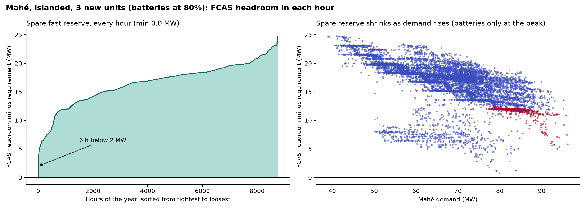

# Seychelles 2035 – FCAS and minimum new thermal (EPM dispatch)

*Runs of 15 October 2026 (after the storage and commitment fixes). Relaxed unit commitment (LP); full on/off (MIP)
check pending.*

## Question

How much new thermal capacity does Mahé need in 2035 to hold the required fast frequency reserve (FCAS) in every
hour, and from which point does the system meet demand but not FCAS? The IRP base case plans 50.4 MW of new HFO.

## Model

- EPM in dispatch mode: two zones (Mahé, Praslin–La Digue) linked by the planned 40 MW cable, 8,760 hours of 2035,
  no capacity expansion. Energy and reserve are co-optimised at least cost.
- Engines: unit commitment (minimum load 30%, minimum up/down time, start-up cost); reserve only while running, up to
  20% of MW, and output + reserve within the committed capacity.
- Batteries: reserve up to 80% (or 50%) of inverter MW; charge + discharge within the inverter; discharge + reserve
  backed by the energy stored at the start of the hour.
- Unmet reserve is reported as FCAS shortfall (penalty USD 1,000 per MW-hour; unserved energy USD 1,000 per MWh).
- Inputs and settings: [`../README.md`](../README.md).

### Local model changes (`epm/base.gms`, `epm/main.gms`, `epm/generate_report.gms`)

| Change | Purpose |
|---|---|
| `eSpinningReserveLimOnline`, `eJointResCapOnline` | Reserve only from running engines; output + reserve within committed capacity |
| `eStorInverterLimit` | Battery charge + discharge share one inverter |
| `eStorEnergyHeadroom` | Battery discharge + reserve backed by the energy stored at the start of the hour |
| `eStorageSOCInitDispatch` / `FinalDispatch` | Battery start/end level anchored only at the start and end of the year (was every month), with the first-hour balance applied |
| `mapAT`, `mapATprev`, `sWinUp`, `sWinDn` | Faster unit-commitment equations (same constraints) |
| `eSpinningReserveReqIntercoTrip` | Interconnector-trip option (largest unit + import), used for PLD |
| Report: `pDispatchPlant` "Charge", "StateOfCharge" | Battery charging and state of charge per unit and hour |

## FCAS requirement

| Case | Requirement per hour |
|---|---|
| Mahé, cable in service | largest unit 8 MW + cable flow 40 MW (fixed) + 10% of solar and wind output = **48 MW + VRE** |
| PLD, cable in service | max(two largest units 4.5 MW, largest unit 2.5 MW + import from Mahé) + 10% of solar and wind output |
| Islanded (no cable) | two largest units + 10% of solar and wind output: Mahé **16 MW**, PLD 4.5 MW |

Maximum Mahé capability with the IRP fleet, all engines online and batteries full:
0.8 × 35 MW (BESS) + 0.2 × 95.6 MW (engines ≥ 6 MW) = **47.1 MW**, below 48 MW + VRE. Each extra 8 MW unit adds 1.6 MW.

## Key assumptions (2035)

| Item | Value |
|---|---|
| Demand | IRP hourly profile as provided: Mahé 590 GWh / 96.2 MW peak; PLD 74 GWh / 12.8 MW |
| Mahé thermal | Victoria C A51/A61/B41/B51 (4 × 8 MW), extension (2 × 7.8 MW), new HFO 6 × 8 MW + 2.4 MW (IRP 50.4 MW) |
| PLD thermal | 14.8 MW LFO (no unit ≥ 6 MW, so no FCAS from PLD engines) |
| Solar / wind | Mahé 42.3 MW solar, 10 MW wind; PLD 29 MW solar, 70 MW wind; rooftop PV excluded |
| Batteries | Mahé 35 MW / 70 MWh; PLD 40 MW / 81 MWh |
| Waste-to-energy | 5 MW on Mahé, no FCAS |
| Thermal availability | Full capacity available in every hour (90% monthly energy limit only) |

## Scenarios

| Scenario | Description |
|---|---|
| `Base_U<k>` | k new 8 MW HFO units (plus the 2.4 MW remainder), batteries at 80% of inverter MW; k = 6 is the IRP |
| `BESS50_U<k>` | as Base, batteries counted at 50% |
| `Islanded_U<k>` | no cable; requirement two largest units + VRE; batteries at 80% |
| `IslBESS50_U<k>` | no cable; batteries at 50% |

## Figures


**Figure 1.** Left: the requirement on Mahé (largest unit + 40 MW cable trip + 10% of solar and wind) against the
reserve Mahé can hold from batteries and engines. Right: annual FCAS shortfall as new thermal is added; the IRP's
50 MW falls short, 74 MW (batteries at 80%) or 130 MW (batteries at 50%) closes the gap.


**Figure 2.** Average FCAS shortfall by month and hour: with the IRP fleet Mahé is short in every hour, worst at
midday (10% of solar output adds to the requirement); with 8 new units only a small midday gap remains.



**Figure 3.** Islanded Mahé with 3 new units, batteries at 80%: spare fast reserve in each hour (reserve that could
be held given the dispatch, minus the requirement). It reaches 0 MW in a few June hours and is below 2 MW in 6 hours;
red points are hours with all engines at full output. With batteries at 50%
([figure](figures/fig3b_islanded_U3_BESS50_fcas_margin.png)) it is below 2 MW in 574 hours.

## Results (Mahé, 2035)

| New 8 MW units | New thermal (MW) | Batteries 80%: FCAS shortfall (MWh/yr; hours; max MW) | Batteries 50%: FCAS shortfall (MWh/yr; hours; max MW) | Islanded, batteries 80%: unserved energy (MWh/yr) | Islanded, batteries 50%: unserved energy (MWh/yr) |
|---|---|---|---|---|---|
| 2 | 18.4 | 71,145; all hours; 11.1 | n/r | **2,961** | **2,973** |
| 3 | 26.4 | 57,097; all hours; 9.4 | n/r | 0 | 0 |
| 4 | 34.4 | 43,044; all hours; 7.9 | n/r | 0 | 0 |
| 5 | 42.4 | 28,951; all hours; 6.2 | n/r | 0 | 0 |
| **6 (IRP)** | **50.4** | **14,800; all hours; 4.6** | 106,817; all hours; 15.1 | 0 | 0 |
| 7 | 58.4 | 3,977; 2,810 h (daytime); 3.0 | 92,612; all hours; 13.5 | n/r | n/r |
| 8 | 66.4 | 628; 1,125 h (midday); 1.4 | 78,255; all hours; 11.9 | n/r | n/r |
| **9** | **74.4** | **0** | 63,836; all hours; 10.3 | n/r | n/r |
| 10 | 82.4 | n/r | 49,438; all hours; 8.6 | n/r | n/r |
| 11 | 90.4 | n/r | 35,077; all hours; 7.0 | n/r | n/r |
| 12 | 98.4 | n/r | 20,719; all hours; 5.5 | n/r | n/r |
| 13 | 106.4 | n/r | 6,407; all hours; 3.8 | n/r | n/r |
| 14 | 114.4 | n/r | 1,483; 1,438 h (midday); 2.2 | n/r | n/r |
| 15 | 122.4 | n/r | 48; 245 h (midday); 0.6 | n/r | n/r |
| **16** | **130.4** | n/r | **0** | n/r | n/r |

n/r = not run (adding units can only reduce shortfall and unserved energy). In both islanded cases the FCAS
requirement (16 MW + VRE) is met at every level; only energy adequacy binds.

- **Minimum new thermal to meet FCAS: 74.4 MW** (9 units) with batteries at 80%; **130.4 MW** (16 units) at 50%
  (15 units leave only 48 MWh of midday shortfall).
- **Minimum new thermal to meet demand** (islanded, either battery case): **26.4 MW** (3 units). Between 3 and 8 units
  the system meets demand but not FCAS.
- Operating cost (excluding penalties, including fixed O&M, no capital cost): USD 73.4 m/yr at 6 units,
  73.5 m/yr at 9 units; islanded about USD 82–84 m/yr, with about 20% of PLD solar and wind curtailed.

Full table: [`scenario_summary_2035.csv`](scenario_summary_2035.csv).

## Caveats

- The 40 MW cable contingency is applied in every hour, including hours when the cable carries less.
- Thermal units are fully available in every hour (no hourly derate or forced outages), and N-2 is tested as fast
  reserve only, not as firm capacity with two units out. The islanded adequacy result (3 units) is therefore
  optimistic.
- Unserved energy and FCAS shortfall have the same penalty, so in FCAS-short cases with the cable the model may shed
  some load instead of reserve (e.g. 654 MWh at 2 units); the islanded runs give the clean adequacy result.
- Batteries may still charge and discharge in the same hour within the inverter limit (energy dumped as losses,
  since curtailment is free); this does not affect Mahé's FCAS results.
- LP relaxation of unit commitment; key cases to be checked as MIP. Run outputs are not in the repository.

## Reproduce

```bash
cd epm
python epm.py --folder_input data_seychelles --scenarios --parallel 2 -S Base_U6 Base_U9 BESS50_U16 Islanded_U3 IslBESS50_U3
```

Run at most 2 scenarios in parallel on a 32 GB machine. The hourly FCAS balance and the summary table are produced
by `analyse_fcas.py` and `summarise_runs.py` (project scripts, not in this repository).
