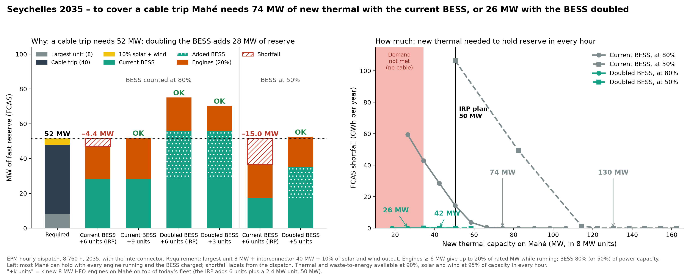
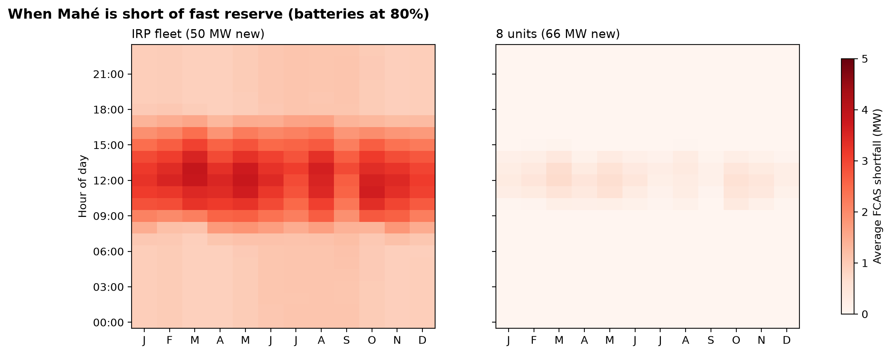
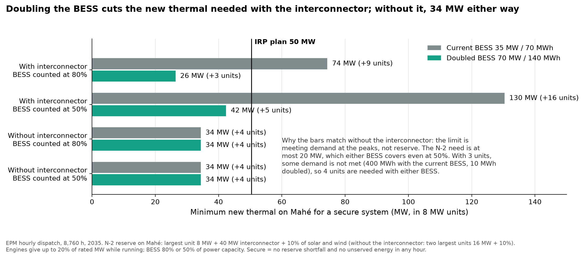
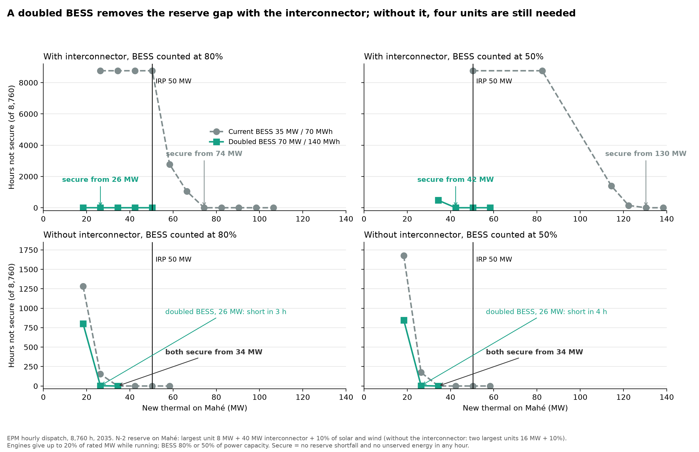
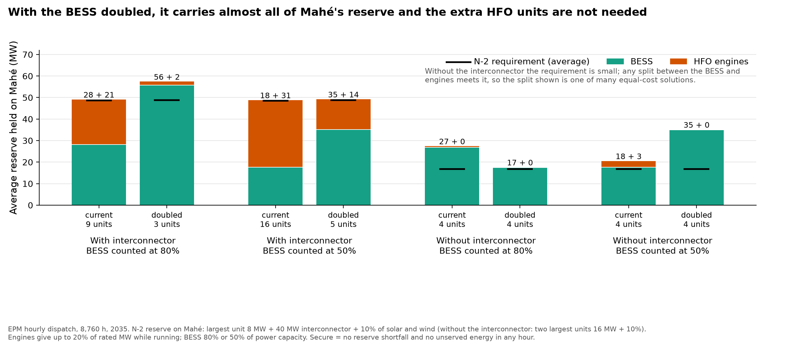
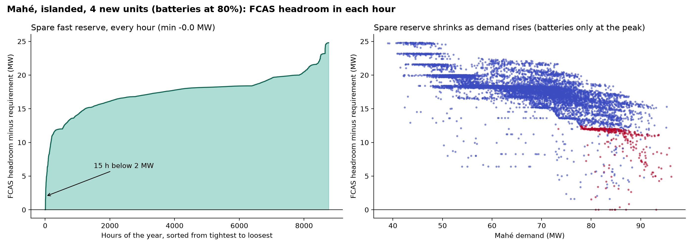
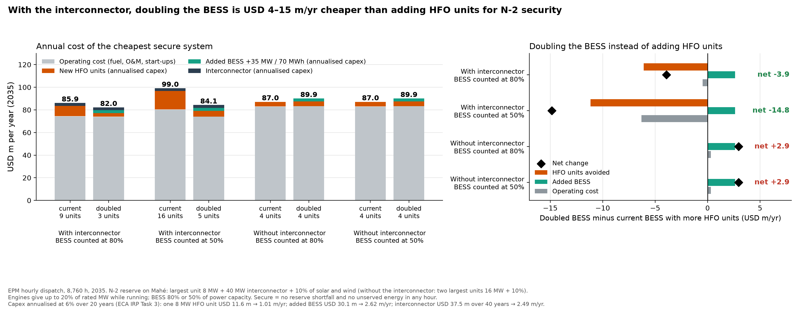

# Seychelles 2035: more HFO units or a bigger BESS for N-2 security on Mahé

*Summary report, draft for discussion – 4 November 2026.*

*This report combines "Seychelles: firm capacity and frequency reserve (FCAS) in 2035" (16 October, updated
21 October 2026) and "Seychelles 2035: a bigger battery on Mahé" (3 November 2026). It adds the doubled BESS without
the interconnector and corrects the one-year cost comparison (see the end of section 4.6).*

## Key messages

1. **Under the N-2 standard, the IRP fleet is short of fast reserve in every hour of 2035.** With the IRP fleet
   (50 MW of new HFO) and the 40 MW interconnector, Mahé must hold 48–52 MW of fast reserve (FCAS): the largest unit
   (8 MW), plus the interconnector (40 MW), plus 10% of solar and wind output. With every engine running and the BESS
   charged, Mahé can hold at most 47 MW.
2. **Closing the gap with HFO alone takes a lot of new thermal.** With Mahé's BESS as planned (35 MW / 70 MWh), Mahé
   needs **74 MW** of new thermal (9 units) if the BESS counts for reserve at 80% of its power capacity, and **130 MW**
   (16 units) if it counts at 50%. Meeting demand alone takes only 34 MW (4 units). The extra units are there to hold
   reserve, not to produce energy.
3. **Doubling the BESS to 70 MW / 140 MWh closes the same gap with far fewer HFO units.** With the interconnector, the
   new thermal needed falls to **26 MW** (3 units) at 80% and **42 MW** (5 units) at 50%. Both are below the IRP's
   50 MW.
4. **Without the interconnector, the limit is meeting demand rather than reserve, and the bigger BESS does not change
   the minimum.** The islanded N-2 requirement is at most 20 MW, which either BESS covers. Four units (34 MW) are
   needed with either BESS size, for energy at the peaks. With the doubled BESS, 3 units fall short in only 3–4 hours
   (10 MWh unserved), compared with about 400 MWh with the current BESS.
5. **The robust minimum is the doubled BESS plus 4 units (34 MW) at 80%, or plus 5 units (42 MW) at 50%.** That fleet
   is secure with and without the interconnector. With the current BESS, the same test needs 9 and 16 units.
6. **With the interconnector, doubling the BESS is the cheaper route to N-2 security.** The added 35 MW / 70 MWh costs
   USD 30 m (USD 2.6 m/yr annualised), about the same as 2.6 HFO units. It replaces 6 units at 80% and 11 units at 50%.
   - Counting operating cost and annualised capital, the cheapest secure system costs **USD 3.9 m/yr less** at 80%
     and **USD 14.8 m/yr less** at 50%.
   - Reserve stops being scarce: the FCAS price on Mahé averages about zero, against USD 50 per MW-h with 9 units and
     the current BESS.
   - Without the interconnector, both BESS sizes need the same 4 new HFO units, so doubling the BESS saves no units.
     It costs about USD 2.9 m/yr more: 2.6 for the added BESS's capital and 0.3 for its fixed O&M, with no fuel
     saving.
7. **The decision that matters most is how much BESS capacity can be counted for the 40 MW interconnector trip.**
   With the doubled BESS it carries almost all of Mahé's reserve (about 56 MW on average). Grid-forming capability,
   and the state of charge kept for reserve, decide whether that is acceptable.

## 1. Question

The Seychelles IRP adds a 40 MW Mahé–Praslin interconnector by 2035, along with large amounts of solar, wind and
battery storage. On Mahé it adds 50 MW of new HFO capacity. As the share of variable renewables grows, the system
must keep enough fast frequency reserve (FCAS) to withstand the loss of its two largest elements (N-2).

This report asks two questions:

- How much new HFO capacity does Mahé need to meet the N-2 standard, compared with what it needs simply to meet
  demand?
- Is doubling Mahé's BESS a more economic way to meet the standard than adding HFO units?

Deb suggested that about 50 MW of new thermal is a sensible answer, but not the cheapest or cleanest. Additional
renewables scenarios were not run: Deb considers the RE build-out sufficient.

## 2. Approach

**Hourly dispatch.** We used the World Bank Electricity Planning Model (EPM) to simulate all 8,760 hours of 2035 for
two zones, Mahé and Praslin–La Digue, linked by the interconnector. In each hour the model decides:

- which engines run and how much they produce;
- how the BESS charges and discharges;
- how much power flows over the cable;
- how much reserve each unit holds.

Energy and reserve are optimised together at least cost. A reserve shortfall costs USD 500 per MW-h and unserved
energy USD 1,000 per MWh, so the model sheds reserve before load.

**N-2 reserve standard.** The reserve requirement is set by the two largest elements:

| Island | Interconnector | Requirement |
|---|---|---|
| Mahé | in service | largest unit (8 MW) + interconnector (40 MW) + 10% of solar and wind output |
| Mahé | not available | two largest units (16 MW) + 10% of solar and wind output |
| Praslin–La Digue | either | two largest units (4.5 MW), or largest unit plus import from Mahé, + 10% of solar and wind output |

**Four cases.** Each case is run with the current BESS and with the doubled BESS:

| Case | Interconnector | BESS counted for reserve at |
|---|---|---|
| 1 | in service | 80% of power capacity |
| 2 | in service | 50% (sensitivity) |
| 3 | not available | 80% |
| 4 | not available | 50% |

**Two BESS options on Mahé:**
- *current BESS:* 35 MW / 70 MWh, as in the IRP;
- *doubled BESS:* 70 MW / 140 MWh, i.e. +35 MW / 70 MWh with the 2-hour duration kept.

The Praslin–La Digue BESS is unchanged in both options.

**Who can provide reserve:**
- HFO engines of 6 MW or more, only while running, up to 20% of rated capacity and within the headroom left by
  their output;
- the BESS, up to 80% (or 50%) of power capacity, limited by the energy stored at the start of each hour.

Smaller engines, waste-to-energy, solar and wind provide no reserve.

**Minimum new thermal.** New HFO is varied in 8 MW units, plus a fixed 2.4 MW unit. A configuration is **secure** if
there is no reserve shortfall and no unserved energy in any hour.

*What "units" means in this report.* "+k units" is the number of **new 8 MW HFO engines added on Mahé by 2035**, on
top of today's fleet. The **IRP fleet** is the IRP plan: 6 new units plus the 2.4 MW unit, 50 MW in total. So
"9 units" is 9 × 8 + 2.4 = 74 MW of new thermal, and "3 units" is 26 MW. The minimum for each case is the fewest
units that make the system secure.

**Annual cost.** EPM's operating cost covers fuel, variable and fixed O&M, and start-ups. We add annualised capital at
6% (ECA IRP Task 3, 2023 USD):

| Investment | Capital cost | Annualised |
|---|---|---|
| One new 8 MW HFO unit | 1,454 USD/kW → USD 11.6 m, 20 years | USD 1.01 m/yr |
| Added BESS, +35 MW / 70 MWh | 60 USD/kW + 400 USD/kWh → USD 30.1 m, 20 years | USD 2.62 m/yr |
| Interconnector, 40 MW | USD 37.5 m, 40 years | USD 2.5 m/yr (only when in service) |

The reserve-shortfall penalty is a modelling device and is not counted as a cost.

## 3. Main assumptions (2035)

| Item | Assumption | Source |
|---|---|---|
| Demand | Mahé 590 GWh, peak 96 MW; Praslin–La Digue 74 GWh, peak 13 MW (hourly profile) | IRP base case |
| Existing and committed thermal (Mahé) | Victoria C: 4 × 8 MW + extension 2 × 7.8 MW (older units retired) | PUC, ECA |
| New thermal (Mahé) | IRP: 50.4 MW, modelled as 6 × 8 MW + 2.4 MW; varied in 8 MW units | ECA IRP; unit size assumed |
| Thermal (Praslin–La Digue) | 14.8 MW of small diesel units | PUC, ECA |
| Solar / wind | Mahé 42 MW / 10 MW; Praslin–La Digue 29 MW / 70 MW; rooftop PV excluded | ECA IRP |
| BESS, Mahé | current 35 MW / 70 MWh; doubled 70 MW / 140 MWh | ECA IRP; scenario |
| BESS, Praslin–La Digue | 40 MW / 81 MWh | ECA IRP |
| Interconnector | 40 MW | ECA IRP |
| Availability | thermal 90%, solar and wind 95%, in every hour; BESS fully available | Assumption |
| Engine operation | minimum load 30%; minimum up/down times; start-up costs | ECA; assumptions |
| Fuel | HFO 18.2, diesel 27.5 USD/MMBtu (2024 prices) | WB strategy note |
| Capital costs | HFO unit 1,454 USD/kW; BESS 60 USD/kW + 400 USD/kWh; 6%, 20 years | ECA IRP Task 3 |

## 4. Results

### 4.1 Why the IRP fleet is short, and what each route adds

With 50 MW of new HFO and the interconnector, Mahé falls short of the N-2 requirement **in every hour**, by up to
4.4 MW. At night the gap is about 1 MW (48 MW required, 47 MW available). In the middle of the day it grows, because
10% of solar output adds to the requirement. Demand is met in every hour.

The two routes add reserve at very different rates:

- **An HFO unit** adds only 1.6 MW of reserve (20% of 8 MW), and only while it runs. Closing the 4.4 MW gap takes
  three more units, 74 MW in total.
- **Doubling the BESS** adds 28 MW of reserve at 80% (left panel of the figure above), so 3 units are then enough.

At 50%, the current BESS leaves a 15 MW gap. That takes 10 more units, 130 MW in total. With the doubled BESS,
5 units are enough.

### 4.2 Minimum new thermal in the four cases

| Case | Current BESS | Doubled BESS | HFO units saved |
|---|---|---|---|
| 1. With interconnector, BESS at 80% | 74 MW (9 units) | **26 MW (3 units)** | 6 |
| 2. With interconnector, BESS at 50% | 130 MW (16 units) | **42 MW (5 units)** | 11 |
| 3. Without interconnector, BESS at 80% | 34 MW (4 units) | 34 MW (4 units) | 0 |
| 4. Without interconnector, BESS at 50% | 34 MW (4 units) | 34 MW (4 units) | 0 |
| **Secure in both 1 and 3** | **74 MW (9 units)** | **34 MW (4 units)** | 5 |
| **Secure in both 2 and 4** | **130 MW (16 units)** | **42 MW (5 units)** | 11 |

The interconnector brings energy from Praslin–La Digue, but its 40 MW contingency must be covered by reserve on Mahé.
Without it, the requirement drops to 16 MW plus the solar and wind share, and the limit becomes energy at the morning
and evening peaks.

**With the interconnector**, reserve is the binding limit.
- At 80%, the doubled BESS alone offers 56 MW of reserve, more than the requirement, as long as it holds enough
  energy; the model keeps it charged for that. The remaining shortfall with 18 MW (2 units) is 2 hours, caused by
  energy rather than reserve: 8 MWh is unserved.
- At 50%, the doubled BESS offers 35 MW and HFO units must cover the rest, so 5 units are needed.

**Without the interconnector, why are the bars the same?** Here the limit is meeting demand, not reserve, so neither
the BESS size nor the 80%/50% rule changes the minimum.

- *Reserve is not binding.* The islanded N-2 requirement is the two largest units (16 MW) plus 10% of solar and wind
  output: 17 MW on average and 20 MW at most. The current BESS at 50% already gives 17.5 MW, and running engines
  cover the rest. With 4 units there is no reserve shortfall in any islanded run.
- *Energy is binding.* With fewer units, Mahé cannot meet demand in some morning and evening hours. It cannot import
  from Praslin–La Digue, and a 2-hour BESS empties before the peak is over:

  | New units | Unserved energy, current BESS | Unserved energy, doubled BESS | Reserve shortfall |
  |---|---|---|---|
  | 2 (18 MW) | 8,700 MWh | 6,400 MWh | 28–620 MWh |
  | 3 (26 MW) | about 400 MWh (150–175 h not secure) | 10 MWh (3–4 h not secure) | 1–88 MWh |
  | 4 (34 MW) | 0 | 0 | 0 |

The doubled BESS shifts more solar into the peaks and almost closes the gap with 3 units. A BESS shifts energy but
does not add it, and units come in whole 8 MW steps, so 4 units remain the minimum with either BESS. A longer-duration
BESS (for example 4 hours) might close the last 10 MWh; this has not been run (section 7).

### 4.3 Who holds the reserve

With the interconnector and the current BESS, reserve is split between the BESS (28 MW) and HFO units (21 MW). This
is why so many units are needed: each must run to contribute. With the doubled BESS at 80%, the BESS holds about
56 MW and HFO units about 2 MW. Mahé then depends almost entirely on the BESS for the 40 MW interconnector trip
(see section 6).

### 4.4 What each route does to operation

| Secure case (with interconnector) | Mahé thermal (GWh/yr) | Operating cost (USD m/yr) | CO₂, both islands (kt/yr) |
|---|---|---|---|
| Current BESS, 9 units, 80% | 437.5 | 74.3 | 305 |
| Doubled BESS, 3 units, 80% | 432.0 | 73.8 | 300 |
| Doubled BESS, 6 units (IRP), 80% | 431.4 | 72.4 | 299 |
| Current BESS, 16 units, 50% | 470.0 | 80.2 | 331 |
| Doubled BESS, 5 units, 50% | 432.9 | 73.9 | 301 |

Extra HFO units barely change energy output or operating cost. Their cost is the investment.

At 50% with the current BESS, the 16 units must run to hold reserve. Less Praslin–La Digue wind can then be
imported, and Mahé's thermal output and fuel bill rise. The doubled BESS avoids this: it shifts about 6 GWh/yr of
solar into the evening and cuts CO₂ by 5–30 kt/yr.

### 4.5 Without the interconnector

The islanded cases are bound by energy (section 4.2). Praslin–La Digue then has to curtail about a fifth of its
solar and wind output.

| Islanded, 4 units | Fuel (USD m/yr) | Operating cost (USD m/yr) | CO₂ (kt/yr) |
|---|---|---|---|
| Current BESS | 76.2 | 82.9 | 340 |
| Doubled BESS | 76.2 | 83.2 (+0.3 BESS fixed O&M) | 340 |

With the current BESS and four units, the spare reserve just reaches zero in a few hours. With five units, at least
9.6 MW is always spare.

### 4.6 Doubling the BESS against adding HFO units: annual cost

The left panel shows the annual cost of the cheapest secure system in each case. The right panel shows the change
when the BESS is doubled instead of adding HFO units: units avoided, the added BESS, the change in operating cost,
and the net result.

| Case | BESS | New units | Operating | New HFO units | Added BESS | Interconnector | **Total** |
|---|---|---|---|---|---|---|---|
| 1. With interconnector, 80% | current | 9 | 74.3 | 9.1 | – | 2.5 | **85.9** |
| | doubled | 3 | 73.8 | 3.0 | 2.6 | 2.5 | **82.0** |
| 2. With interconnector, 50% | current | 16 | 80.2 | 16.2 | – | 2.5 | **99.0** |
| | doubled | 5 | 73.9 | 5.1 | 2.6 | 2.5 | **84.1** |
| 3. Without interconnector, 80% | current | 4 | 82.9 | 4.1 | – | – | **87.0** |
| | doubled | 4 | 83.2 | 4.1 | 2.6 | – | **89.9** |
| 4. Without interconnector, 50% | current | 4 | 82.9 | 4.1 | – | – | **87.0** |
| | doubled | 4 | 83.2 | 4.1 | 2.6 | – | **89.9** |

USD m/yr, 2035; capital annualised at 6%.

- **With the interconnector, doubling the BESS is cheaper.**

  | | At 80% | At 50% |
  |---|---|---|
  | HFO units avoided | 6 (−6.1 m/yr) | 11 (−11.2 m/yr) |
  | Added BESS | +2.6 m/yr | +2.6 m/yr |
  | Operating cost | −0.5 m/yr | −6.3 m/yr |
  | **Net** | **−3.9 m/yr** | **−14.8 m/yr** |

  - The robust fleet (doubled BESS plus 4 units, secure also without the cable) costs USD 82.3 m/yr, USD 3.7 m/yr
    less than 9 units with the current BESS.
  - Keeping the IRP's 6 units with the doubled BESS costs USD 83.6 m/yr, still USD 2.4 m/yr less.
- **Without the interconnector, the doubled BESS does not pay.** Both BESS sizes need the same 4 new HFO units
  (section 4.2), so nothing is avoided:

  | Doubled minus current BESS, islanded | USD m/yr |
  |---|---|
  | HFO units avoided | 0 |
  | Added BESS, capital | +2.62 |
  | Added BESS, fixed O&M (in operating cost) | +0.32 |
  | Fuel (76.2 in both) | 0 |
  | **Net** | **+2.94** |

  The added BESS earns its keep by covering the interconnector trip; if Mahé is islanded it has no reserve gap to
  close.
- **The interconnector's value depends on how the BESS is treated for its contingency:**
  - With the doubled BESS, the cable is clearly worth building: secure for USD 82.0–84.1 m/yr with it, against 87.0
    without it.
  - With the current BESS at 80%, the cable just pays: 85.9 against 87.0.
  - With the current BESS at 50%, the reserve the cable demands (16 units) makes it more expensive than going without:
    99.0 against 87.0.

*Correction to the 3 November note.* Its one-year comparison added fixed O&M for the new HFO units and the added
BESS on top of EPM's operating cost, which already includes it. The net savings there (USD 2.4 / 3.9 / 4.3 /
15.8 m/yr) become USD 2.4 / 3.7 / 3.9 / 14.8 m/yr. The conclusions do not change.

### 4.7 Value of reserve

The FCAS price is the model's marginal cost of meeting the N-2 requirement. It shows how scarce reserve is:

| Case | Average (USD/MW-h) | Maximum | Hours at or above USD 100 |
|---|---|---|---|
| Current BESS, IRP fleet (6 units) | 500 (penalty, short every hour) | 500 | 8,760 |
| Current BESS, 9 units, 80% | 50 | 445 | about 1,200 |
| Current BESS, 16 units, 50% | 116 | 500 | about 3,500 |
| Doubled BESS, 3 units, 80% | 0 | 36 | 0 |
| Doubled BESS, 6 units (IRP), 80% | 0 | 21 | 0 |
| Doubled BESS, 5 units, 50% | 28 | 334 | 234 |
| Without interconnector, 4 units (either BESS) | 0 | 19 | 0 |

With the doubled BESS at 80%, reserve on Mahé is plentiful in almost every hour.

## 5. Comparison with the worst-hour spreadsheet

The earlier spreadsheet found a Mahé shortfall of 4.1 MW with the IRP fleet; the dispatch finds up to 4.4 MW. The two
are consistent. The small difference comes from the solar and wind share, and from how the reserve held by the unit
that trips is counted.

The dispatch adds the hourly picture: the shortfall occurs in every hour, is largest at midday, and is not removed by
realistic operation of HFO units and the BESS.

## 6. Caveats

- **BESS treatment.** The model has no inertia or grid-forming behaviour; the 80% and 50% counts are the proxy. With
  the doubled BESS, the system relies on the BESS for nearly all of the 40 MW interconnector contingency.
- **Contingency in every hour.** The 40 MW interconnector contingency is applied in every hour, including hours when
  the cable carries less power. This is conservative.
- **Availability.** Availability is a fixed 90% (thermal) and 95% (solar, wind) in every hour, not random outages.
  The BESS is fully available.
- **Engine operation is simplified.** The runs use relaxed unit commitment; a full on/off check of the key cases is
  still to be done.
- **One year only.** There is no BESS degradation or mid-life replacement, and HFO units last longer than a BESS.
  Annualised costs are indicative.
- **Without the interconnector.** In the cost comparison, "without interconnector" means the cable is not built. As a
  reliability check, it also stands for the cable being out of service.
- **Unconfirmed inputs.** The unit size of the new HFO plant (assumed 8 MW) and the availability of the Victoria B/C
  units in 2035 are not confirmed. Rooftop PV is excluded (demand is treated as net of rooftop).

## 7. Next steps

1. Discuss with PUC and ECA how much BESS capacity can be counted for the interconnector trip (grid-forming
   capability, state of charge kept for reserve). With the doubled BESS this decides between about 34 MW and 42 MW of
   new thermal, and whether the interconnector pays for itself.
2. Confirm with PUC the new plant unit size and which Victoria B/C units are kept in 2035.
3. Run a full on/off check of the key cases: doubled BESS with 4 and 5 units, and 9 units with the current BESS.
4. Optional: other BESS shapes (for example 4-hour duration, which might bring the islanded minimum from 4 to 3
   units), a cable flow limit, or midday solar curtailment as further ways to close the reserve gap.

## Annex: all runs

Hours of 2035 in which Mahé is not secure (reserve shortfall or unserved energy). For secure cases, operating cost is
shown in brackets (USD m/yr). "–" means not run: these cases lie beyond the thresholds, and adding units can only
reduce the shortfall. Runs with 90–106 MW and 138–162 MW (all secure) are omitted.

| New thermal | Cable, 80%, current | Cable, 80%, doubled | Cable, 50%, current | Cable, 50%, doubled | No cable, 80%, current | No cable, 80%, doubled | No cable, 50%, current | No cable, 50%, doubled |
|---|---|---|---|---|---|---|---|---|
| 18 MW (2) | – | 2 h, 8 MWh unserved | – | – | 1,282 h, 8,704 MWh unserved | 800 h, 6,365 MWh unserved | 1,678 h, 8,714 MWh unserved | 848 h, 6,365 MWh unserved |
| 26 MW (3) | 8,760 h | **secure** (73.8) | – | – | 153 h, 406 MWh unserved | 3 h, 10 MWh unserved | 174 h, 410 MWh unserved | 4 h, 10 MWh unserved |
| 34 MW (4) | 8,760 h | **secure** (73.1) | – | 476 h | **secure** (82.9) | **secure** (83.2) | **secure** (82.9) | **secure** (83.2) |
| 42 MW (5) | 8,760 h | **secure** (72.7) | – | **secure** (73.9) | **secure** (82.3) | – | **secure** (82.3) | – |
| 50 MW (6, IRP) | 8,760 h | **secure** (72.3) | 8,760 h | **secure** (73.4) | **secure** (81.9) | – | **secure** (81.9) | – |
| 58 MW (7) | 2,779 h | – | – | **secure** (73.0) | **secure** (81.6) | – | **secure** (81.6) | – |
| 66 MW (8) | 1,045 h | – | – | – | – | – | – | – |
| 74 MW (9) | **secure** (74.3) | – | – | – | – | – | – | – |
| 82 MW (10) | **secure** (74.0) | – | 8,760 h | – | – | – | – | – |
| 114 MW (14) | – | – | 1,401 h | – | – | – | – | – |
| 122 MW (15) | – | – | 147 h | – | – | – | – | – |
| 130 MW (16) | – | – | **secure** (80.2) | – | – | – | – | – |

---

*Model runs: EPM branch `seychelles_2026`, input folder `epm/input/data_seychelles`. Run folders:
`epm/output/simulations_run_20261016_115419` (current BESS), `simulations_run_20261027_BESS2x` (doubled BESS with the
interconnector) and `simulations_run_20261104_Isl2x` (doubled BESS without it). Tables:
`results/scenario_summary_2035.csv`, `_BESS2x.csv`, `_Isl2x.csv`, `cheapest_secure_2035.csv`, `fcas_prices_2035.csv`,
`fcas_prices_2035_BESS2x.csv`. Figures 2–3: `epm_inputs/make_figures.py`, `fcas_margin.py`; Figures 1b and 6–9:
`epm_inputs/make_figures_summary.py`. The dual-fuel LNG scenario (27 October 2026) was set aside on 3 November; it is
kept in `results/vintage/LNG_dropped_2026-11-03/`.*
