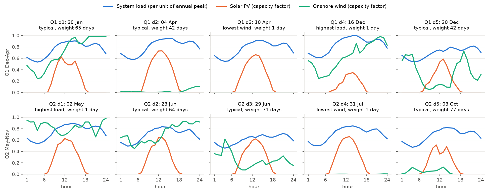
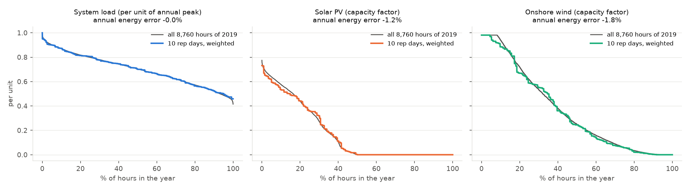

# Greater Malé representative days

**Status:** 13 Nov 2026. In `epm/input/data_MDV`: `pHours.csv`, `load/pDemandProfile.csv`, `supply/pVREProfile.csv`.

## What they are

10 days stand in for the year: 5 per season, with weights that add up to 365 days.

- **Seasons:** Q1 dry (Dec–Apr, 151 days) and Q2 wet (May–Nov, 214 days), as in the existing `pHours.csv`.
- **In each season:**
  - 2 special days, weight 1:
    - the day with the highest hourly system load;
    - the day with the lowest daily onshore wind.
  - 3 typical days, chosen by the Poncelet method (the BiH and Albania method). The method chooses the days and weights so the duration curves and correlations of these series match the season:
    - system load;
    - Malé fixed PV;
    - Malé onshore wind;
    - Malé 2-axis PV;
    - load–PV, load–wind and PV–wind.
  - Both seasons are solved to a 1% optimality gap.
- **Data:**
  - Load: the 2019 hourly island file in `pre-analysis/maldives_vre/data/`. Hour 1 is 00:00–01:00 local time. Each zone is divided by its own annual peak.
  - VRE: the 2019 hours from `pre-analysis/maldives_vre`, the same year as the load. 2019 wind was 16% below the 2015–2023 mean, so wind is scaled to that mean, without going above the highest hourly value of 2015–2023. Solar is not changed.
- **Profiles in `pVREProfile`:**
  - PV, FPV and RPV all use the fixed-PV profile.
  - OnshoreWind and OffshoreWind each have their own.
  - The five islands are within about 10 km of each other, so their profiles are nearly the same.

## The days

| Season | Day | Date | Type | Weight (days) |
|---|---|---|---|---|
| Q1 | d1 | 30 Jan | typical | 65 |
| Q1 | d2 | 4 Apr | typical | 42 |
| Q1 | d3 | 10 Apr | lowest wind | 1 |
| Q1 | d4 | 16 Dec | highest load | 1 |
| Q1 | d5 | 20 Dec | typical | 42 |
| Q2 | d1 | 2 May | highest load | 1 |
| Q2 | d2 | 23 Jun | typical | 64 |
| Q2 | d3 | 29 Jun | typical | 71 |
| Q2 | d4 | 31 Jul | lowest wind | 1 |
| Q2 | d5 | 3 Oct | typical | 77 |

On the peak-load days, solar and wind are the values actually measured on those days, not averages. This is how the EPM representative-day method works.

## How well they match the year

Energy error is the weighted mean of the 10 days against the mean of all 8,760 hours of 2019.

| Series | Year | Q1 | Q2 | Duration-curve error (NRMSE) |
|---|---|---|---|---|
| System load | 0.0% | -0.2% | +0.1% | 0.9% |
| Malé load | -0.4% | -0.8% | -0.1% | 1.1% |
| Hulhumalé load | +2.3% | +2.9% | +1.8% | 3.3% |
| Villingili load | -1.4% | -0.1% | -2.4% | 2.9% |
| Gulhifalhu load | +1.4% | +2.1% | +0.9% | 1.7% |
| Thilafushi load | -0.4% | -1.2% | +0.3% | 1.1% |
| PV, worst island | 1.3% | 3.8% | 3.3% | 2.0% |
| Onshore wind, worst island | 2.0% | 2.2% | 1.9% | 2.2% |
| Offshore wind, worst island | 2.9% | 2.0% | 3.9% | 2.8% |

## Note for EPM

EPM scales each zone's load profile to the forecast peak, then adjusts it to match the forecast energy (`load/pDemandForecast*.csv`). The current forecasts imply lower load factors than the 2019 hourly data, for example Malé 0.47 against 0.68. EPM's adjustment then cuts mainly the night-time load. The forecast is being reviewed. The representative days depend only on the shape of the load, so they do not change when the forecast does.
