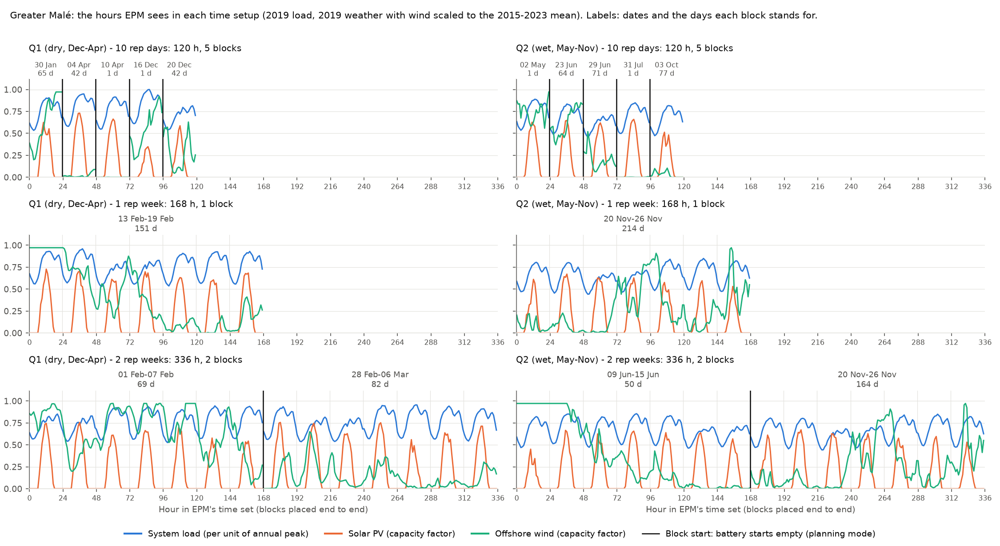

# Greater Malé representative weeks (test)

**Status:** 16 Nov 2026. Proposed, not yet in `epm/input/data_MDV`, which still uses the 10 days in [REPDAYS.md](REPDAYS.md).

## Why weeks

In planning mode, EPM starts each representative block with an empty battery and carries the charge hour by hour to the end of the block. There is no link between blocks. With 24-hour days, a battery cannot move energy from one day to the next. With a 168-hour block it can, and only the first night of each week starts empty. No change to the model code is needed.

## What they are

- **Data, seasons:** the same as the 10 days (2019 load, 2019 weather with wind scaled to the 2015–2023 mean; Q1 dry Dec–Apr, Q2 wet May–Nov).
- **Blocks:** 168 hours starting at 00:00 on any day of the week. A week stays in one season and does not cross 31 Dec.
- **Choice:** every candidate week (or pair of weeks) is scored with the same objective as the Poncelet method: duration curves of system load, Malé fixed PV, onshore wind and 2-axis PV, and the load–PV, load–wind and PV–wind correlations. All options are scored, so the result is the exact best and the same on every run.
- **Weights:** with 2 weeks, whole days, each week at least 7, adding up to the season's days. In `pHours.csv`, each hour gets days / 7.
- **Hours:** `t001`..`t168`. There are no special days (a 24-hour day cannot sit in the 168-hour set).

| Setup | Season | Dates (2019) | Weight (days) |
|---|---|---|---|
| 1 week | Q1 | 13–19 Feb | 151 |
| 1 week | Q2 | 20–26 Nov | 214 |
| 2 weeks | Q1 | 1–7 Feb | 69 |
| 2 weeks | Q1 | 28 Feb–6 Mar | 82 |
| 2 weeks | Q2 | 9–15 Jun | 50 |
| 2 weeks | Q2 | 20–26 Nov | 164 |

## The hours EPM sees

Blocks are placed end to end. The black line is a block start, where the battery starts empty: every day with the 10 days, once a week with the weeks.

## How well they match the year

Largest error over the five zones; energy error is the weighted mean against the mean of all 8,760 hours of 2019.

| Profiles | Error | 10 days | 1 week | 2 weeks |
|---|---|---|---|---|
| Island loads | annual energy | 2.3% | 2.2% | 2.5% |
| | seasonal energy | 2.9% | 2.2% | 2.5% |
| | duration curve (NRMSE) | 3.3% | 2.1% | 1.9% |
| Fixed PV | annual energy | 1.3% | 0.9% | 1.1% |
| | seasonal energy | 3.8% | 6.1% | 3.5% |
| | duration curve | 1.9% | 1.2% | 0.8% |
| Tracking PV | annual energy | 1.8% | 1.7% | 2.9% |
| | seasonal energy | 4.0% | 6.2% | 4.1% |
| Onshore wind | annual energy | 2.0% | 1.8% | 0.8% |
| | seasonal energy | 2.2% | **10.1%** | 1.7% |
| | duration curve | 2.2% | 2.2% | 1.5% |
| Offshore wind | annual energy | 2.9% | 2.0% | 0.8% |
| | seasonal energy | 3.9% | **12.1%** | 1.7% |
| | duration curve | 2.7% | 2.1% | 1.5% |

Daily PV capacity factor (cloudy days matter for battery sizing):

| Percentile of days | Full year | 10 days | 1 week | 2 weeks |
|---|---|---|---|---|
| 5th (cloudiest) | 0.095 | 0.107 | 0.121 | 0.112 |
| 25th | 0.157 | 0.139 | 0.155 | 0.149 |
| 50th | 0.184 | 0.177 | 0.187 | 0.176 |

## Reading

- **2 weeks** match the year as well as the 10 days or better, except annual tracking-PV energy (2.9% against 1.8%). They give 672 hours instead of 240.
- **1 week** per season is not enough: seasonal wind is 10–12% off.
- The weeks leave out the two extreme days of each season (highest load, lowest wind) that the 10 days keep with weight 1. EPM's reserve margin is set on the forecast peak, not on these hours.
- None of the setups has a day as cloudy as the year's cloudiest 5%.
